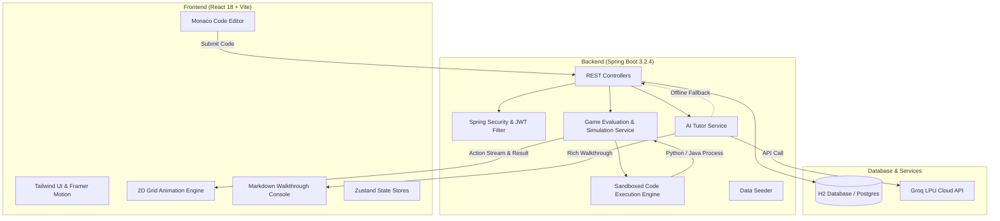

# 🚀 CodeQuest (GameLearn)

> **Gamified Coding Learning Platform for Python & Java with Real-Time Simulation and AI Tutoring.**

[](https://spring.io/projects/spring-boot)
[](https://www.oracle.com/java/)
[](https://react.dev/)
[](https://www.typescriptlang.org/)
[](https://vitejs.dev/)
[](https://tailwindcss.com/)
[](https://microsoft.github.io/monaco-editor/)
[](https://groq.com/)
[](#)

---

## 🌟 Overview

**CodeQuest** is a modern, gamified educational platform that teaches computer science and programming fundamentals through interactive puzzle solving. Instead of passive tutorials, learners write real **Python** or **Java** code to command an autonomous robotic rover across 2D grid landscapes—avoiding obstacles, collecting elemental crystals, and reaching the goal portal.

The platform bridges game-based learning with professional tooling: code is written in a full **Monaco Editor** (the engine powering VS Code), compiled and executed securely on the backend, and simulated step-by-step with synchronized animations, sound effects, and diagnostic feedback.

---

## 🎯 Key Features

### 🎮 1. Visual 2D Grid Simulation
- **Tile-Based World Engine**: Dynamic grid supporting custom map sizes (5×5 up to 9×9), wall barriers, start locations, directional headings, collectible energy crystals, and exit portals.
- **Synchronized Playback**: Step-by-step action animator executes `move()`, `turn_right()`, `turn_left()`, and `collect()` with synchronized audio effects and line-highlighting in the code editor.
- **Star Rating System**: Complete missions with maximum efficiency and collect all gems to earn 1, 2, or 3 stars.

### 💻 2. Real Sandboxed Code Execution
- **Multi-Language Support**: Seamlessly switch between **Python 3** and **Java 17**.
- **Action Extraction Engine**: Backend wrappers compile and execute user code, intercepting motion commands and streaming structured simulation actions back to the frontend.
- **Accurate Error Mapping**: Compiler syntax errors and runtime exceptions are mapped directly back to the student's line of code.

### 🤖 3. Intelligent AI Companion (Byte)
- **Smart Error Debugger (`/api/ai/debug-error`)**: Pinpoints the exact faulty line, explains why the issue occurred in beginner-friendly language, and provides the exact code correction.
- **Step-by-Step Solution Walkthrough (`/api/ai/solution`)**: Generates structured, readable walkthroughs with code snippets, movement breakdowns, and obstacle avoidance logic.
- **Concept Deep-Dive (`/api/ai/explain-concept`)**: Explains the computer science concept used in that level (e.g., Sequencing, For Loops, Variables, While Loops, Functions, Nested Loops) with syntax examples and common pitfalls.
- **Tactical Hints (`/api/ai/hint`)**: Progressive, cost-tiered hints that nudge learners without spoiling the solution.
- **Resilient Fallback Engine**: If no Groq API key is present or the network is offline, a built-in deterministic engine provides comprehensive walkthroughs and diagnostics.

### 📖 4. High-Readability Walkthrough Console
- **Dedicated Markdown Renderer**: Beautifully renders AI explanations, markdown tables, callout cards (Tips 💡, Warnings ⚠️, Strategies 🎯), ordered step badges, and styled code blocks with copy-to-clipboard functionality.
- **Maximize / Expand Mode**: Console height toggle (288px up to ~580px) for comfortable, full-screen reading without cramped scrolling.

### 🏆 5. Progression & Gamification
- **XP & Coin Economy**: Earn XP and coins by solving levels, completing daily challenges, and unlocking achievements.
- **Dynamic Leaderboard**: Track global player rankings based on total stars, completed levels, and accumulated XP.
- **Achievement Showcase**: Unlock badges for milestone achievements (First Steps, Loop Master, Code Warrior, Star Collector).
- **Daily Challenges**: Auto-rotating daily puzzle with **2x XP & coin rewards**.

### 🔐 6. Authentication & Security
- **JWT (JSON Web Token)**: Stateless authentication with BCrypt password hashing.
- **Spring Security 6**: Granular access control, CORS configuration, and authenticated user endpoints.

---

## 🏗️ System Architecture



---

## 🛠️ Tech Stack

### Frontend
| Technology | Version | Purpose |
| :--- | :--- | :--- |
| **React** | 18.3.1 | Core UI component framework |
| **TypeScript** | 5.5.3 | Static typing and maintainability |
| **Vite** | 5.4.1 | High-speed frontend build tool & dev server |
| **Tailwind CSS** | 3.4.10 | Utility-first responsive dark theme styling |
| **Monaco Editor** | 4.6.0 | In-browser code editing (Python & Java) |
| **Framer Motion** | 11.5.4 | Smooth UI transitions and victory animations |
| **Zustand** | 4.5.5 | Lightweight reactive client state management |
| **Axios** | 1.7.5 | Promise-based HTTP client with JWT interceptors |
| **Lucide React** | 0.438.0 | Vector iconography |

### Backend
| Technology | Version | Purpose |
| :--- | :--- | :--- |
| **Spring Boot** | 3.2.4 | Enterprise Java REST framework |
| **Java JDK** | 17 LTS | Modern LTS Java runtime |
| **Spring Data JPA** | 3.2.4 | ORM repository layer |
| **Spring Security** | 6.2 | Role-based authentication & authorization |
| **JJWT** | 0.12.5 | Cryptographic JWT token generation and parsing |
| **H2 Database** | 2.2.x | Lightweight, persistent file/in-memory SQL database |
| **Hibernate** | 6.4.x | Object-Relational Mapping (ORM) |
| **Lombok** | 1.18.x | Boilerplate code reduction |
| **SpringDoc OpenAPI** | 2.5.0 | Automated Swagger UI & OpenAPI 3 documentation |

### AI Integration
| Component | Detail |
| :--- | :--- |
| **Provider** | [Groq Cloud](https://groq.com/) High-Speed LPU Inference |
| **Default Models** | `llama-3.3-70b-versatile` / `openai/gpt-oss-120b` |
| **Fallback Engine** | Built-in offline deterministic solution, concept & debug generator |

---

## 🗺️ Course Curriculum (15 Levels)

Both **Python Adventure** and **Java Quest** feature 15 progressive levels:

| Level | Title | Concept | Grid | Difficulty | Reward |
| :---: | :--- | :--- | :---: | :---: | :---: |
| **1** | First Steps | Sequencing & Commands | 5×5 | `EASY` | 50 XP / 10 Coins |
| **2** | The Long Bridge | For Loops & Repetition | 3×8 | `EASY` | 75 XP / 15 Coins |
| **3** | Variable Supply Run | Variables & Memory Storage | 3×6 | `EASY` | 80 XP / 20 Coins |
| **4** | The Maze | Direction Control & Turning | 6×6 | `MEDIUM` | 100 XP / 20 Coins |
| **5** | The Forking Paths | Conditionals (`if` / `else`) | 5×5 | `MEDIUM` | 120 XP / 25 Coins |
| **6** | Crystal Collector | Resource Collection & Timing | 5×6 | `MEDIUM` | 100 XP / 25 Coins |
| **7** | The Infinite Tunnel | While Loops & Counters | 3×7 | `MEDIUM` | 130 XP / 30 Coins |
| **8** | Modular Patrol | Functions with Parameters | 5×5 | `HARD` | 160 XP / 35 Coins |
| **9** | Boss: The Loop Dragon 🐉 | Labyrinth Navigation & Loops | 7×7 | `HARD` | 300 XP / 100 Coins |
| **10** | Debug: The Broken Rover 🔧 | Bug Hunting & Syntax Fixes | 5×6 | `MEDIUM` | 125 XP / 40 Coins |
| **11** | Nested Fortress | Nested Loops & Sweeping | 5×5 | `HARD` | 200 XP / 50 Coins |
| **12** | The Gem Gauntlet | Lists / Arrays & Iteration | 7×7 | `HARD` | 220 XP / 55 Coins |
| **13** | Spiral Tower | Spiral Algorithms & Decrementing | 6×6 | `HARD` | 250 XP / 60 Coins |
| **14** | The Mirror Labyrinth | Functions, Methods & Code Reuse | 8×8 | `HARD` | 280 XP / 70 Coins |
| **15** | Final Boss: The Code Titan 🏆 | Grand Boss (All Concepts) | 9×9 | `HARD` | 500 XP / 200 Coins |

---

## 📁 Project Structure

```text
GameLearn/
├── backend/                               # Spring Boot Application
│   ├── src/main/java/com/codequest/
│   │   ├── AI_Service/                    # AI Tutor Controller, Service & Groq Client
│   │   ├── config/                        # OpenAPI / CORS / Security configurations
│   │   ├── controller/                    # REST API Controllers (Auth, Game, Level, etc.)
│   │   ├── dto/                           # Data Transfer Objects
│   │   ├── engine/                        # Code Execution, Wrappers & Evaluation
│   │   ├── entity/                        # JPA Entities (User, Level, World, Course, etc.)
│   │   ├── exception/                     # Global Exception Handlers
│   │   ├── repository/                    # Spring Data Repositories
│   │   ├── security/                      # JWT Service, Filter & User Details
│   │   ├── seeder/                        # DataSeeder (Seeds courses & 30 levels)
│   │   └── service/                       # Business Logic Layer
│   ├── src/main/resources/
│   │   └── application.yml                # Backend configuration & Groq settings
│   ├── data/                              # Persistent H2 database storage
│   └── pom.xml                            # Maven Dependencies
│
├── frontend/                              # React + TypeScript + Vite Application
│   ├── src/
│   │   ├── components/
│   │   │   ├── layout/                    # AppLayout, Navbar, ProtectedRoute
│   │   │   └── ui/                        # Button, Card, Modal, MarkdownRenderer, etc.
│   │   ├── editor/                        # Monaco Editor wrapper & Toolbar
│   │   ├── game/                          # GameBoard, GameEngine, TerminalConsole, MissionPanel
│   │   ├── pages/                         # Landing, Login, Dashboard, GameLevel, Leaderboard, etc.
│   │   ├── services/                      # Axios API clients
│   │   ├── stores/                        # Zustand stores (Auth, Game, Progress)
│   │   ├── types/                         # TypeScript interfaces
│   │   └── utils/                         # Audio effects & sound synthesis
│   ├── package.json                       # Frontend dependencies & scripts
│   ├── tailwind.config.js                 # Tailwind CSS theme configuration
│   └── vite.config.ts                     # Vite build configuration
│
├── AI_Service/                            # AI Service documentation
│   └── README.md
├── docker-compose.yml                     # Optional PostgreSQL container definition
└── README.md                              # This documentation
```

---

## ⚡ Quick Start Guide

### Prerequisites
- **Java**: JDK 17 or higher
- **Node.js**: v18.0.0 or higher
- **Python**: Python 3.10+ (installed and available on your system `PATH` for running user Python code)
- **Maven**: 3.8+ (or use standard Maven CLI)

---

### Step 1: Clone the Repository
```bash
git clone <repository-url>
cd GameLearn
```

---

### Step 2: Configure & Start the Backend

1. Navigate to the backend directory:
   ```bash
   cd backend
   ```

2. *(Optional)* Configure your **Groq API Key** in `src/main/resources/application.yml` or as an environment variable:
   ```yaml
   app:
     groq:
       api-key: your_groq_api_key_here
       model: llama-3.3-70b-versatile
   ```
   > 💡 **Note:** If no key is set, the application will automatically use the built-in offline educational walkthrough engine.

3. Compile and launch the Spring Boot server:
   ```bash
   mvn spring-boot:run
   ```

   The backend starts at: **`http://localhost:8081`**
   - **Swagger API Docs**: `http://localhost:8081/swagger-ui/index.html`
   - **H2 DB Console**: `http://localhost:8081/h2-console` (JDBC URL: `jdbc:h2:file:./data/codequestdb`, User: `sa`, Password: `password`)

---

### Step 3: Configure & Start the Frontend

1. In a new terminal, navigate to the frontend directory:
   ```bash
   cd frontend
   ```

2. Install dependencies:
   ```bash
   npm install
   ```

3. Start the Vite development server:
   ```bash
   npm run dev
   ```

   The frontend is available at: **`http://localhost:5173`**

---

## 📡 Key REST API Endpoints

| Category | Method | Endpoint | Description | Public? |
| :--- | :---: | :--- | :--- | :---: |
| **Auth** | `POST` | `/api/auth/register` | Register a new learner account | Yes |
| **Auth** | `POST` | `/api/auth/login` | Authenticate and obtain JWT token | Yes |
| **Courses** | `GET` | `/api/courses` | List all available learning tracks | No |
| **Levels** | `GET` | `/api/levels/{id}` | Get full level data, grid map & starter code | No |
| **Game** | `POST` | `/api/game/run` | Execute code, test against grid, return actions | No |
| **Daily** | `GET` | `/api/daily-challenge` | Retrieve today's featured challenge | No |
| **Leaderboard** | `GET` | `/api/leaderboard` | View top global rankings | No |
| **Achievements** | `GET` | `/api/achievements` | List player achievements and unlocked status | No |
| **AI Tutor** | `POST` | `/api/ai/debug-error` | AI diagnosis and line error explanation | Yes |
| **AI Tutor** | `POST` | `/api/ai/solution` | Step-by-step solution walkthrough | Yes |
| **AI Tutor** | `POST` | `/api/ai/explain-concept` | In-depth computer science concept deep-dive | Yes |
| **AI Tutor** | `POST` | `/api/ai/hint` | Tactical hint guidance | Yes |

---

## 🎮 How to Play

1. **Sign Up / Log In**: Create an account or sign in to track your progress and XP.
2. **Choose Your Language**: Select **Python Adventure** (🐍) or **Java Quest** (☕).
3. **Select a Level**: Start at Level 1 (*First Steps*) on the interactive World Map.
4. **Write Code**: Use standard movement commands in the Monaco editor:
   - **Python**: `move()`, `turn_right()`, `turn_left()`, `collect()`
   - **Java**: `move();`, `turnRight();`, `turnLeft();`, `collect();`
5. **Run & Observe**: Click **"Run Code"** to watch the rover simulate your code in real-time.
6. **Seek Guidance**: If stuck, click **"AI Walkthrough"** to view a line-by-line strategy breakdown or **"Explain Concept"** to master the underlying logic.
7. **Advance & Compete**: Level up, earn stars, collect badges, and climb the Leaderboard!

---

## 🛡️ License

This project is licensed under the **MIT License**. Feel free to use, modify, and distribute it for educational or personal projects.

---


